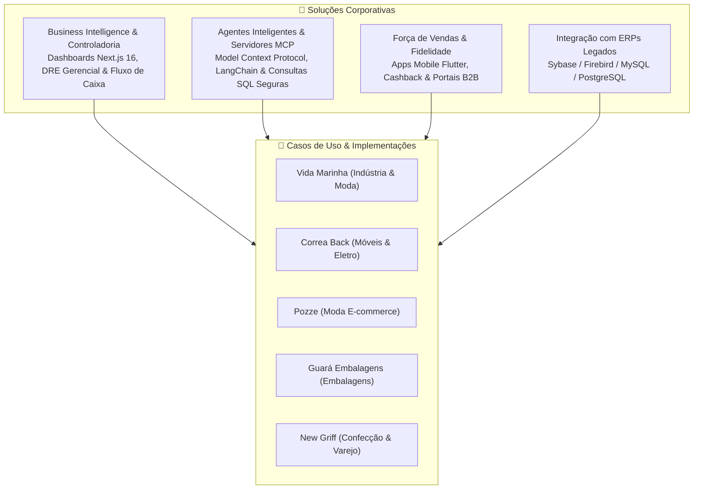

# 🎯 Alvo7 App — Portfólio de Soluções & Casos de Sucesso

Bem-vindo à vitrine de tecnologia e soluções analíticas da **Alvo7 App**. Esta organização é dedicada à demonstração de arquiteturas, dashboards executivos, motores de compras e ferramentas de inteligência de negócios desenvolvidas para o ecossistema corporativo e varejista.

---

## 🏛️ Capacidades & Especialidades de Engenharia

---

## 💼 Ecossistema de Produtos

- **Dashboards Executivos & DRE:** Interfaces de alta performance desenvolvidas em Next.js e TypeScript com processamento multithread de demonstrações financeiras.
- **Motores Determinísticos de Compra:** Algoritmos preditivos que calculam lead time de fornecedores, curvas ABC e índices sazonais sobre bases legadas em modo estrito de leitura.
- **Servidores MCP (Model Context Protocol):** Integrações modernas de Inteligência Artificial que viabilizam consultas estruturadas e seguras a bancos de dados de produção por agentes inteligentes.
- **Automação de Processos com n8n:** Centenas de workflows e webhooks de mensageria integrando retaguardas ERP a canais de atendimento e WhatsApp.
